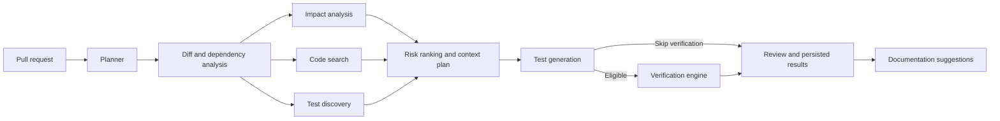

# TestPilot AI

**English** | [简体中文](README.zh-CN.md)

[](https://github.com/Stan20021130/TestPilot-AI/actions/workflows/ci.yml)
[](https://github.com/Stan20021130/TestPilot-AI/actions/workflows/cd.yml)
[](LICENSE)

TestPilot AI is a regression-testing and code-intelligence platform. It indexes repositories, analyzes pull request changes and their dependencies, retrieves relevant context, and uses an LLM to generate tests and reviews. A LangGraph pipeline coordinates analysis; a separate verification engine runs and repairs generated tests and can propose source patches for human review.

The project is under active development. The current verification runner targets Python and pytest, and some integrations and security boundaries require further work; see [Current limitations](#current-limitations).


## Capabilities

- **Code and impact analysis:** Tree-sitter parsing, changed-symbol and contract extraction, dependency traversal, and risk ranking.
- **Context retrieval:** Qdrant vector search, database keyword search, and repository file scanning.
- **Test generation and verification:** LLM-generated tests, selected existing tests, bounded repair rounds, and Python mutation probes.
- **Pull request review:** Persisted analysis, warnings, verification outcomes, and a draft review. An authenticated API endpoint can post a pending review to GitHub.
- **Repository integrations:** Provider adapters for GitHub, GitLab, Bitbucket, and Azure DevOps, plus generic Git operations. The analysis pipeline still has GitHub-specific paths.
- **Operations:** Celery workers, optional persistent checkpoints, Prometheus, Grafana, OpenTelemetry, and Flower.

**Stack:** Next.js 16 and React 19; Python 3.12, FastAPI, LangGraph, and LiteLLM; PostgreSQL, Redis, and Qdrant.

## How it works



The context subgraph runs impact analysis, search, and test discovery in parallel. It may decline generation if the available context is insufficient. When the PR head can be fetched, analysis uses a separate Git worktree; otherwise it falls back to the indexed checkout and records a warning.

Verification is a contracts-first engine with a deterministic controller. Its tools execute tests, repair generated tests, propose source patches, and probe mutations. Source patches remain proposals; they are not applied automatically. The documentation node currently produces basic suggestions rather than updating documentation.

## Quickstart

### Prerequisites

- Docker Engine or Docker Desktop with Compose, and Git.
- An accessible LLM endpoint and credentials for test generation.
- GitHub OAuth credentials to sign in through the dashboard. GitHub App credentials and a public webhook URL are needed for App/webhook integration.

The first image build and the first download of the local embedding model can take time. The example configuration uses development secrets; replace them before exposing any service.

### 1. Prepare configuration

From a new checkout, using a POSIX shell:

```bash
git clone https://github.com/Stan20021130/TestPilot-AI.git
cd TestPilot-AI
cp .env.example .env
touch backend/private-key.pem
```

In PowerShell, use `Copy-Item .env.example .env` and, if needed, `New-Item backend/private-key.pem -ItemType File` instead of the last two commands. Do not overwrite an existing `.env` or private key. The empty key file only satisfies the Compose bind mount; replace it with your GitHub App private key when using App authentication.

Edit `.env` for your setup. For example, when using OpenAI's API:

```dotenv
OPENAI_API_KEY=your-openai-api-key
OPENAI_API_BASE=https://api.openai.com/v1
LITELLM_DEFAULT_MODEL=gpt-4o-mini

# Required for GitHub OAuth login
GITHUB_CLIENT_ID=your-github-client-id
GITHUB_CLIENT_SECRET=your-github-client-secret

# Required for GitHub App authentication and webhook verification
GITHUB_APP_ID=your-github-app-id
GITHUB_APP_PRIVATE_KEY_PATH=/app/private-key.pem
GITHUB_WEBHOOK_SECRET=your-webhook-secret
GITHUB_APP_NAME=your-github-app-slug
```

The configuration default for `OPENAI_API_BASE` points to a local endpoint inside the backend container; setting an API key alone does not change it. For another provider, configure the model, endpoint, and credentials for that provider. `GITHUB_TOKEN` can be set for fetching PR refs from private repositories. Keep credentials and private keys out of version control.

The base Compose file mounts `backend/private-key.pem` at `/app/private-key.pem`, while `.env.example` uses a different path. Set `GITHUB_APP_PRIVATE_KEY_PATH` as shown when using that mount.

### 2. Start services and migrate the database

```bash
docker compose -f docker-compose.yml up -d --build
docker compose -f docker-compose.yml exec backend alembic upgrade head
docker compose -f docker-compose.yml ps
```

These commands explicitly select the base Compose file: the automatically loaded development override contains machine-specific private-key mounts. Check startup logs with `docker compose -f docker-compose.yml logs -f backend celery-worker`. Stop the stack with `docker compose -f docker-compose.yml down`; named volumes are retained.

| Service | Local address |
| :--- | :--- |
| Dashboard | [http://localhost:3000](http://localhost:3000) |
| API documentation | [http://localhost:8000/docs](http://localhost:8000/docs) |
| API health | [http://localhost:8000/health](http://localhost:8000/health) |
| Flower | [http://localhost:5555](http://localhost:5555) |
| Grafana | [http://localhost:3001](http://localhost:3001) |
| Prometheus | [http://localhost:9090](http://localhost:9090) |
| Qdrant dashboard | [http://localhost:6333/dashboard](http://localhost:6333/dashboard) |

After signing in, connect and index a repository. PR analysis can be requested through the API for an existing PR record; its response and warnings should be checked in the dashboard or API. The frontend may display labeled sample data when backend data is unavailable.

For GitHub OAuth, register `http://localhost:3000/auth/callback` as the local callback URL. For webhook delivery, configure a reachable URL such as `https://your-host/api/v1/webhooks/github` and use the same webhook secret in GitHub and `.env`. Review the integration limitations below before relying on webhook-triggered analysis.

## Configuration

| Setting | Purpose |
| :--- | :--- |
| `DATABASE_URL`, `REDIS_URL`, `QDRANT_URL` | Connections used by the backend; Compose service hostnames differ from host development. |
| `OPENAI_API_KEY`, `OPENAI_API_BASE`, `LITELLM_DEFAULT_MODEL` | LLM credentials, endpoint, and model used for generation and review. |
| `USE_LOCAL_EMBEDDINGS`, `SENTENCE_TRANSFORMER_MODEL` | Select local embeddings and the Sentence Transformers model. If loading fails, the implementation falls back to hash vectors. |
| `GITHUB_CLIENT_ID`, `GITHUB_CLIENT_SECRET` | GitHub OAuth login. App integration additionally needs `GITHUB_APP_ID`, `GITHUB_APP_PRIVATE_KEY_PATH`, and `GITHUB_WEBHOOK_SECRET`. |
| `SANDBOX_MODE` | `subprocess` by default; an experimental `docker` mode also exists. See the limitations below. |
| `MAX_VERIFY_ROUNDS`, `VERIFY_MAX_STEPS` | Bounds on verification rounds and controller steps. |
| `CHECKPOINT_BACKEND` | `memory`, `postgres`, or `off`. The base Compose worker explicitly overrides this to `postgres`. |

See [.env.example](.env.example) and [backend configuration](backend/app/core/config.py) for the remaining settings. If changing database or Redis passwords, update both the service credentials and their connection URLs. `NEXT_PUBLIC_API_URL` is embedded during the Next.js build; the current frontend Dockerfile does not pass the Compose `env_file` into that build, so changing it requires adjusting the build configuration and rebuilding the image.

## Development and checks

For native development, use Python 3.12 and Poetry for the backend, and Node.js 20.9+ with npm for the frontend. PostgreSQL, Redis, and Qdrant can be run with Compose; host-run processes need `localhost` connection strings instead of Compose hostnames.

```bash
# Backend, from the repository root
cd backend
poetry install --with dev
poetry run pytest tests/ -v
```

```bash
# Frontend, from the repository root
cd frontend
npm ci
npm run lint
npm run build
```

The Poetry-based Makefile test and lint targets execute inside the backend container, but its image installs dependencies with pip and does not include Poetry or the development tools. Use the native commands above or add those tools to a development image. See the [developer setup guide](docs/setup.md) for more background; prefer the prerequisites and Compose commands above where older instructions differ.

## Current limitations

- **Verification:** The current verification adapter runs pytest and parses JUnit XML. Framework detection and generation schemas mention other languages, but that does not make Jest, JUnit, or Go Test supported by this verification runner.
- **Execution isolation:** The default subprocess mode scrubs environment variables and applies resource limits on POSIX, but it is not a security boundary and does not isolate network or filesystem access. Docker mode requires a Docker CLI and daemon, neither of which is provided to the worker by the default Compose setup; its workspace and dependencies require additional configuration.
- **PR automation:** Analysis stores a draft review; posting it uses the explicit GitHub review endpoint. Provider PR-creation methods exist, but the main pipeline does not automatically create a PR. The standalone test generation and execution endpoints currently return status messages rather than starting independent jobs.
- **Webhooks:** The receiver dispatches provider-derived IDs without resolving or creating the corresponding internal repository and PR records, so a `202` response does not establish that analysis succeeded. Azure DevOps webhook verification currently accepts requests without validating the secret, and the Bitbucket adapter accepts a missing signature; harden these paths before exposing them to untrusted traffic.
- **Checkpoints:** PostgreSQL checkpoints can resume interrupted work when the associated worktree still exists; otherwise the analysis starts again.

## Benchmarks

The repository includes a 100-case dataset and experimental evaluation reports:

- [Live LLM generation report](docs/benchmarks/eval_100_live_llm_zero_to_one.md) and its [script](backend/scripts/eval_100_live_llm_zero_to_one_3concurrent.py)
- [Multi-gate report](docs/benchmarks/eval_100_real_github_reverts_optimized.md), [recorded results](docs/benchmarks/eval_100_real_github_reverts_optimized.json), and [script](backend/scripts/eval_100_real_github_reverts_optimized.py)
- [Generation case studies](docs/benchmarks/eval_live_llm_zero_to_one_report.md)

Treat the reported results as experimental, not validated defect-recall estimates: the live-generation script counts runner errors as catches and overrides the classification of specific cases, while the multi-gate script uses a hard-coded baseline. The benchmark scripts also require local checkouts under `test_repos/`; the live script expects a local LLM endpoint.

## Project layout

```text
backend/app/agents/       LangGraph pipeline and context orchestration
backend/app/verify/       Verification controller, contracts, tools, and runner
backend/app/api/          FastAPI routes and WebSocket endpoints
backend/app/services/     Indexing, retrieval, VCS, and execution services
backend/app/tasks/        Celery tasks
backend/tests/            Backend tests
frontend/                 Next.js dashboard
infra/                    Nginx, PostgreSQL, Prometheus, Grafana, and OTEL config
docs/                     Architecture, feature notes, and benchmark reports
```

Further reading: [system architecture](docs/architecture.md), [code search and indexing](docs/features/CODE_SEARCH_AND_INDEXING.md), [test generation and verification](docs/features/TEST_GENERATION_AND_VERIFICATION.md), and [provider architecture](docs/features/VCS_PROVIDERS.md). Some feature notes and plans describe earlier implementations; use the code and the limitations above for current behavior.

## License

[MIT](LICENSE).
