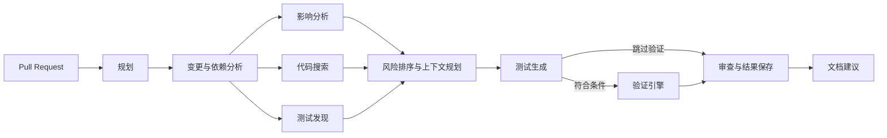

# TestPilot AI

[English](README.md) | **简体中文**

[](https://github.com/Stan20021130/TestPilot-AI/actions/workflows/ci.yml)
[](https://github.com/Stan20021130/TestPilot-AI/actions/workflows/cd.yml)
[](LICENSE)

TestPilot AI 是一个回归测试与代码分析平台。它为代码仓库建立索引，分析 Pull Request 的代码变更及其依赖，检索相关上下文，并使用大语言模型生成测试和审查意见。LangGraph 流水线负责协调整个分析过程，独立的验证引擎负责执行和修复生成的测试，也可以提出供人工审查的源代码补丁。

项目仍在开发中。目前的验证执行器面向 Python 和 pytest，部分集成和安全隔离能力仍需完善，详见[当前限制](#当前限制)。


## 功能

- **代码与影响分析：** 使用 Tree-sitter 解析代码，提取变更的符号和契约，遍历依赖关系并评估风险。
- **上下文检索：** 结合 Qdrant 向量搜索、数据库关键词搜索和仓库文件扫描。
- **测试生成与验证：** 通过大语言模型生成测试，选择已有测试执行，并在设定次数内修复测试、对 Python 代码进行变异探测。
- **Pull Request 审查：** 保存分析结果、警告、验证结果和审查草稿。通过需要身份验证的 API，可以将待发布的审查意见提交到 GitHub。
- **仓库集成：** 提供 GitHub、GitLab、Bitbucket、Azure DevOps 的适配器及通用 Git 操作；分析流水线中仍有部分逻辑针对 GitHub。
- **运行与监控：** 使用 Celery 工作进程，可选持久化检查点，并接入 Prometheus、Grafana、OpenTelemetry 和 Flower。

**技术栈：** Next.js 16、React 19；Python 3.12、FastAPI、LangGraph、LiteLLM；PostgreSQL、Redis、Qdrant。

## 工作原理



上下文子图并行执行影响分析、代码搜索和测试发现。如果可用上下文不足，流水线可能拒绝生成测试。能够获取 PR 的最新提交时，分析会使用独立的 Git worktree；否则会退回到已索引的检出目录并记录警告。

验证引擎以契约为基础，由确定性控制器调度。它可以执行测试、修复生成的测试、提出源代码补丁并进行变异探测。源代码补丁仅作为建议，不会自动应用。目前的文档节点只生成基本建议，不会直接更新文档。

## 快速开始

### 环境要求

- Docker Engine 或 Docker Desktop（包含 Compose），以及 Git。
- 用于生成测试的可访问大语言模型服务和相应凭据。
- 通过仪表盘登录所需的 GitHub OAuth 凭据；使用 GitHub App 和 Webhook 集成还需要 App 凭据及公网可访问的 Webhook 地址。

首次构建镜像和下载本地嵌入模型可能需要一些时间。示例配置中的密钥仅供开发使用，对外开放服务前请替换。

### 1. 准备配置

在 POSIX shell 中，从新检出的仓库开始：

```bash
git clone https://github.com/Stan20021130/TestPilot-AI.git
cd TestPilot-AI
cp .env.example .env
touch backend/private-key.pem
```

在 PowerShell 中，最后两条命令可分别替换为 `Copy-Item .env.example .env` 和 `New-Item backend/private-key.pem -ItemType File`；私钥文件已存在时无需创建。请勿覆盖已有的 `.env` 或私钥。空的私钥文件仅用于满足 Compose 的文件挂载要求；使用 GitHub App 身份验证时，请将其替换为 App 私钥。

根据环境编辑 `.env`。例如，使用 OpenAI API 时：

```dotenv
OPENAI_API_KEY=your-openai-api-key
OPENAI_API_BASE=https://api.openai.com/v1
LITELLM_DEFAULT_MODEL=gpt-4o-mini

# GitHub OAuth 登录所需
GITHUB_CLIENT_ID=your-github-client-id
GITHUB_CLIENT_SECRET=your-github-client-secret

# GitHub App 身份验证和 Webhook 校验所需
GITHUB_APP_ID=your-github-app-id
GITHUB_APP_PRIVATE_KEY_PATH=/app/private-key.pem
GITHUB_WEBHOOK_SECRET=your-webhook-secret
GITHUB_APP_NAME=your-github-app-slug
```

`OPENAI_API_BASE` 的默认值指向后端容器内的本地服务，仅设置 API 密钥不会改变该地址。使用其他服务商时，请配置对应的模型、服务地址和凭据。可以设置 `GITHUB_TOKEN`，以便获取私有仓库的 PR 引用。不要将凭据和私钥提交到版本库。

基础 Compose 文件将 `backend/private-key.pem` 挂载到 `/app/private-key.pem`，而 `.env.example` 中的路径不同。使用该挂载时，请按上例设置 `GITHUB_APP_PRIVATE_KEY_PATH`。

### 2. 启动服务并迁移数据库

```bash
docker compose -f docker-compose.yml up -d --build
docker compose -f docker-compose.yml exec backend alembic upgrade head
docker compose -f docker-compose.yml ps
```

这些命令显式选择基础 Compose 文件，因为自动加载的开发覆盖文件包含特定机器上的私钥挂载路径。使用 `docker compose -f docker-compose.yml logs -f backend celery-worker` 查看启动日志。使用 `docker compose -f docker-compose.yml down` 停止服务；具名卷会保留。

| 服务 | 本地地址 |
| :--- | :--- |
| 仪表盘 | [http://localhost:3000](http://localhost:3000) |
| API 文档 | [http://localhost:8000/docs](http://localhost:8000/docs) |
| API 健康检查 | [http://localhost:8000/health](http://localhost:8000/health) |
| Flower | [http://localhost:5555](http://localhost:5555) |
| Grafana | [http://localhost:3001](http://localhost:3001) |
| Prometheus | [http://localhost:9090](http://localhost:9090) |
| Qdrant 仪表盘 | [http://localhost:6333/dashboard](http://localhost:6333/dashboard) |

登录后，连接仓库并建立索引。对于已有的 PR 记录，可以通过 API 请求分析，并在仪表盘或 API 中查看结果和警告。后端数据不可用时，前端可能显示带有标识的示例数据。

使用 GitHub OAuth 时，请将 `http://localhost:3000/auth/callback` 注册为本地回调地址。接收 Webhook 时，请配置可访问的地址，例如 `https://your-host/api/v1/webhooks/github`，并确保 GitHub 和 `.env` 中使用相同的 Webhook 密钥。依赖 Webhook 触发分析前，请先阅读下方的集成限制。

## 配置项

| 配置项 | 用途 |
| :--- | :--- |
| `DATABASE_URL`、`REDIS_URL`、`QDRANT_URL` | 后端连接地址；Compose 内的服务名与宿主机开发时的地址不同。 |
| `OPENAI_API_KEY`、`OPENAI_API_BASE`、`LITELLM_DEFAULT_MODEL` | 生成测试和审查意见所需的大语言模型凭据、服务地址和模型。 |
| `USE_LOCAL_EMBEDDINGS`、`SENTENCE_TRANSFORMER_MODEL` | 选择本地嵌入方式和 Sentence Transformers 模型；模型加载失败时会回退到哈希向量。 |
| `GITHUB_CLIENT_ID`、`GITHUB_CLIENT_SECRET` | GitHub OAuth 登录配置。App 集成还需要 `GITHUB_APP_ID`、`GITHUB_APP_PRIVATE_KEY_PATH` 和 `GITHUB_WEBHOOK_SECRET`。 |
| `SANDBOX_MODE` | 默认为 `subprocess`；也有实验性的 `docker` 模式，详见下方限制。 |
| `MAX_VERIFY_ROUNDS`、`VERIFY_MAX_STEPS` | 验证轮次和控制器步骤的上限。 |
| `CHECKPOINT_BACKEND` | 可选 `memory`、`postgres` 或 `off`。基础 Compose 文件会将工作进程中的该值显式设为 `postgres`。 |

其他配置项见 [.env.example](.env.example) 和[后端配置](backend/app/core/config.py)。修改数据库或 Redis 密码时，请同时更新服务凭据和连接 URL。`NEXT_PUBLIC_API_URL` 在 Next.js 构建时嵌入；当前前端 Dockerfile 不会在构建时读取 Compose 的 `env_file`，因此修改该地址需要调整构建配置并重新构建镜像。

## 开发与检查

本地开发时，后端使用 Python 3.12 和 Poetry，前端使用 Node.js 20.9+ 和 npm。PostgreSQL、Redis 和 Qdrant 可通过 Compose 运行；在宿主机上运行的进程需要使用 `localhost`，而不是 Compose 服务名。

```bash
# 后端：从仓库根目录开始
cd backend
poetry install --with dev
poetry run pytest tests/ -v
```

```bash
# 前端：从仓库根目录开始
cd frontend
npm ci
npm run lint
npm run build
```

Makefile 中基于 Poetry 的测试和 lint 目标会在后端容器内执行，但当前镜像使用 pip 安装依赖，不包含 Poetry 或开发工具。可以使用上面的本地命令，或将这些工具加入开发镜像。[开发环境指南](docs/setup.md)提供了更多背景；若其中的旧说明与本文不同，请以上述环境要求和 Compose 命令为准。

## 当前限制

- **验证：** 当前验证适配器使用 pytest 执行测试并解析 JUnit XML。虽然框架检测和生成数据结构提到了其他语言，但这并不代表该验证执行器支持 Jest、JUnit 或 Go Test。
- **执行隔离：** 默认的 subprocess 模式会清理环境变量，并在 POSIX 系统上施加资源限制，但它不是安全边界，也不会隔离网络或文件系统。Docker 模式需要 Docker CLI 和守护进程；默认 Compose 配置没有向工作进程提供它们，工作目录和依赖也需要额外配置。
- **PR 自动化：** 分析过程会保存审查草稿；发布草稿需要显式调用 GitHub 审查接口。虽然服务商适配器提供创建 PR 的方法，主流水线不会自动创建 PR。独立的测试生成和执行接口目前只返回状态信息，不会启动单独的任务。
- **Webhook：** 接收器直接使用服务商提供的 ID 分发任务，没有查找或创建对应的内部仓库和 PR 记录，因此返回 `202` 并不代表分析成功。Azure DevOps Webhook 目前在未校验密钥的情况下也会接受请求，Bitbucket 适配器也会接受缺少签名的请求；向不可信网络开放前需要加固这些流程。
- **检查点：** 对应的 worktree 仍然存在时，PostgreSQL 检查点可以恢复中断的任务；否则分析会重新开始。

## 基准测试

仓库包含一个 100 个案例的数据集及实验性评测报告：

- [实时大模型生成报告](docs/benchmarks/eval_100_live_llm_zero_to_one.md)及其[脚本](backend/scripts/eval_100_live_llm_zero_to_one_3concurrent.py)
- [多重门禁报告](docs/benchmarks/eval_100_real_github_reverts_optimized.md)、[记录结果](docs/benchmarks/eval_100_real_github_reverts_optimized.json)和[脚本](backend/scripts/eval_100_real_github_reverts_optimized.py)
- [测试生成案例](docs/benchmarks/eval_live_llm_zero_to_one_report.md)

这些结果属于实验数据，不能视为经过验证的缺陷召回率：实时生成脚本会将执行器错误计为捕获，并覆盖特定案例的分类；多重门禁脚本使用硬编码的基线。运行基准脚本还需要在 `test_repos/` 下准备本地仓库，实时生成脚本需要本地大语言模型服务。

## 项目目录

```text
backend/app/agents/       LangGraph 流水线与上下文编排
backend/app/verify/       验证控制器、契约、工具和执行器
backend/app/api/          FastAPI 路由和 WebSocket 接口
backend/app/services/     索引、检索、VCS 和执行服务
backend/app/tasks/        Celery 任务
backend/tests/            后端测试
frontend/                 Next.js 仪表盘
infra/                    Nginx、PostgreSQL、Prometheus、Grafana 和 OTEL 配置
docs/                     架构、功能说明和基准测试报告
```

延伸阅读：[系统架构](docs/architecture.md)、[代码搜索与索引](docs/features/CODE_SEARCH_AND_INDEXING.md)、[测试生成与验证](docs/features/TEST_GENERATION_AND_VERIFICATION.md)、[服务商适配架构](docs/features/VCS_PROVIDERS.md)。部分功能说明和计划文档描述的是旧实现；了解当前行为时，请以代码和上文的限制说明为准。

## 许可证

[MIT](LICENSE)。
