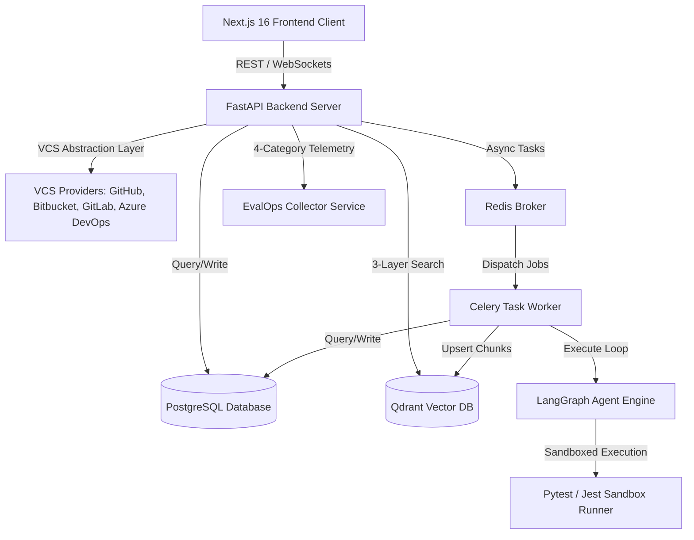
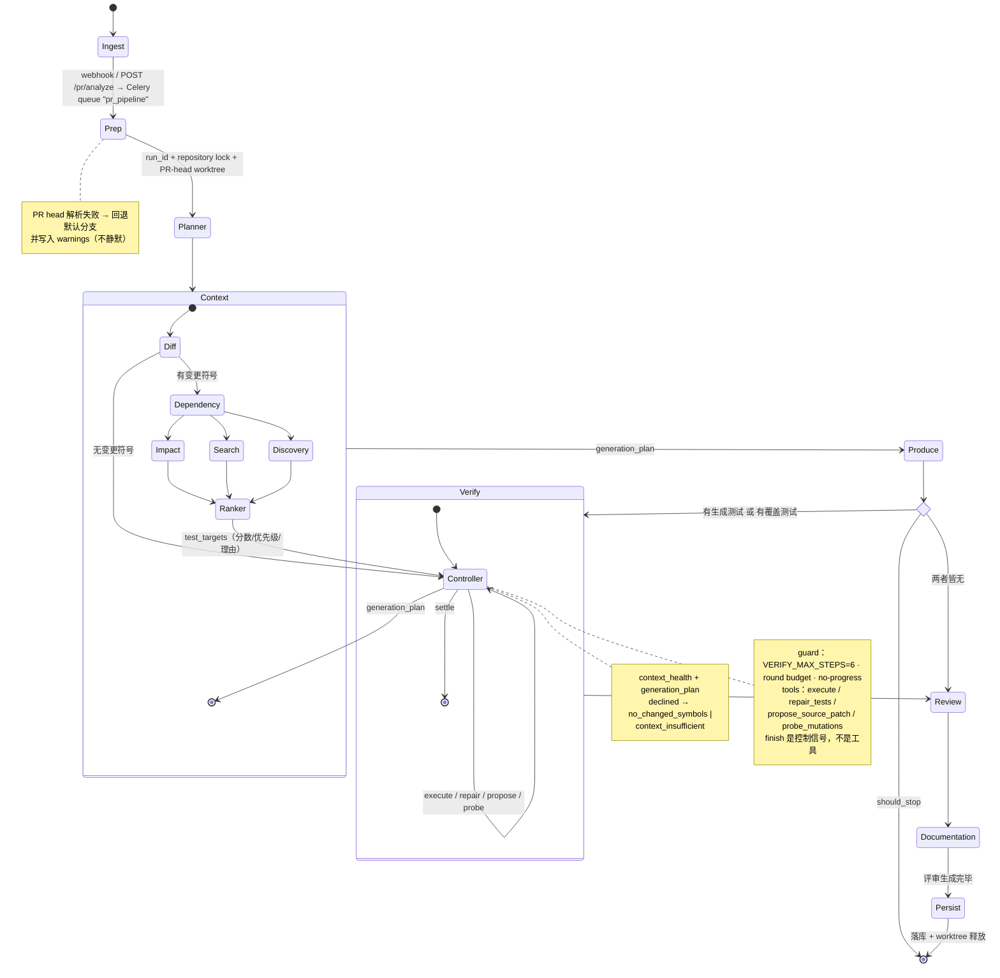
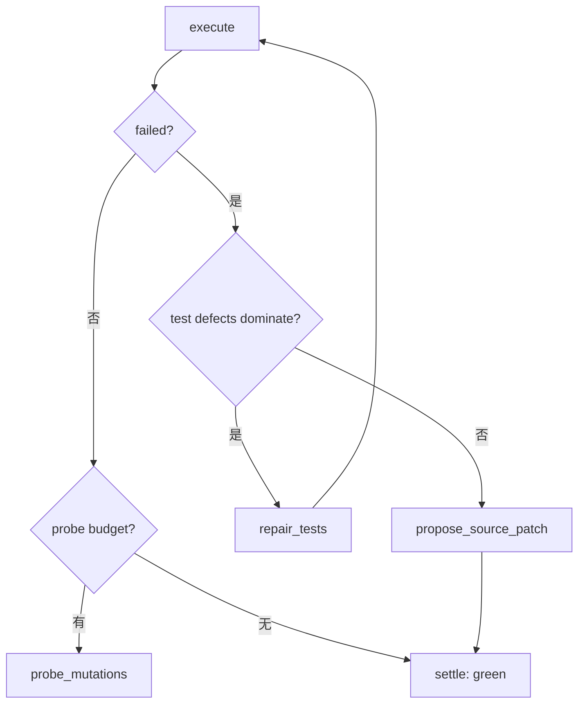

# TestPilot AI — System Architecture (Present State)

TestPilot AI is structured as an enterprise-grade, decoupled web application with background distributed task workers, vector search indexing, multi-VCS provider integration, and an EvalOps telemetry engine.

---

## Architecture Diagram

---

## Core Architecture Components

### 1. Web Client (`frontend/src`)
- Built with **Next.js 16**, **React 19**, **TailwindCSS**, and Lucide icons.
- Features Multi-VCS Repository Connect Modal (GitHub, Bitbucket 1-Click OAuth 2.0, GitLab, Azure DevOps, Custom Git), Repository Selector scoping, 3-Layer Code Search, interactive PR analysis, and the Live **EvalOps Telemetry Dashboard**.

### 2. API Backend (`backend/app`)
- Powered by **FastAPI**, **Async SQLAlchemy 2**, and **Pydantic v2**.
- Implements Multi-VCS Provider Abstraction Layer (`vcs_base.py`), upfront REST API validation, GitHub OAuth 2.0 & 1-Click Dev Authentication, JWT session management, 3-layer hybrid code search (`Qdrant` + `PostgreSQL` + `Disk`), and EvalOps telemetry endpoints.

### 3. VCS Provider Abstraction (`backend/app/services/vcs/`)
- Unified `VCSProvider` interface abstracting repository metadata fetching, PAT authentication headers, and HTTPS clone URL token injections for **GitHub**, **Bitbucket**, **GitLab**, **Azure DevOps**, and **Generic Git**.

### 4. Task Worker (`celery` & `FastAPI BackgroundTasks`)
- Handles non-interactive background repository indexing (`GIT_TERMINAL_PROMPT="0"`), AST parsing via Tree-sitter, embedding generation, remote branch fallbacks, and PR pipeline execution.

### 5. Vector, Relational & Telemetry Storage
- **PostgreSQL**: Stores relational models for Users, Repositories, RepositoryFiles, PR Analyses, and Generated Tests. The application schema is owned exclusively by Alembic migrations (`alembic upgrade head`); the application performs no runtime DDL. The one exception is the LangGraph checkpoint schema, which `PostgresSaver.setup()` creates idempotently on first use when `CHECKPOINT_BACKEND=postgres` — that schema belongs to LangGraph, the same way Celery's result tables belong to Celery.
- **Analysis outcomes**: each completed PR stores `verify_exit_reason`, `verify_rounds`, `context_mode` and a `generation_plan_summary` (JSON), so EvalOps can aggregate green/budget-exhausted/declined rates without replaying the decision log.
- **Checkpoint bookkeeping**: `analysis_checkpoints(thread_id, pull_request_id, completed_at)` records finished threads. A daily Celery task deletes threads older than `CHECKPOINT_RETENTION_DAYS` through `PostgresSaver.delete_thread()` and refuses to run if the saver degraded to memory, which would orphan the real rows.
- **Qdrant**: Stores 384-dimensional dense vectors (`code_symbols` and `repository_chunks`) for hybrid semantic code retrieval.
- **EvalOps Collector**: Collects Pass@1/Pass@N quality benchmarks, self-healing iteration repair metrics, token consumption, context warning rate, and time-series trends.

### 6. Runtime Isolation & Execution Safety
- **PR head checkout** (`app/services/pr_checkout.py`): the index clone holds the default branch, so each run materialises the PR revision as a git worktree (`refs/pull/<n>/head`, merge-request and pull-request refs, or a direct SHA fetch) and every agent reads that tree. When the head cannot be resolved the run degrades to the default branch **with a warning** instead of silently analysing stale code.
- **Per-run workspace**: every analysis run gets its own scratch directory (`testpilot-<run_id>-*`) for runner reports and `HOME`, and writes generated tests under run-scoped file names. Concurrent PRs of the same repository can no longer overwrite each other's tests or read each other's reports.
- **Repository lock**: indexing and PR analysis take a per-repository lock (`mkdir`-based, portable, stale-lock reclaim) before mutating the checkout, so a pull or repair cannot rewrite the working tree mid-run.
- **Sandboxed execution** (`app/services/sandbox.py`): generated code runs with a scrubbed environment (no LLM keys, `DATABASE_URL`, JWT or VCS secrets), POSIX CPU/memory/file-size limits, and — with `SANDBOX_MODE=docker` — inside a `--network=none`, read-only container as a non-root user.
- **Honest health checks**: `/health` returns `503` with per-dependency status when PostgreSQL, Redis or Qdrant is unreachable, so load balancers stop routing to a broken instance.
- **WebSocket authorization**: `/ws/pr/{id}` and `/ws/indexing/{id}` require `?token=<access_token>` and verify that the caller owns the PR or repository before streaming.
- **Checkpointed runs** (`app/agents/checkpointing.py`, `runner.py`): each PR revision has a stable checkpoint thread (`sha256(pr_id, head_sha)`). With `CHECKPOINT_BACKEND=postgres`, a retried analysis loads the state after the last completed superstep and resumes at the interrupted node instead of paying for every LLM stage again. Resume is gated on a pending node plus a live deterministic worktree — a crash inside the verify subgraph leaves the parent snapshot's values empty (state is namespaced under the subgraph), so requiring parent values would disable resume exactly where it matters most. The PR-head worktree survives retries (released only on success or the final attempt), because a checkpoint without its tree cannot be resumed. A completed thread is never reused for a fresh input: append-only channels would otherwise merge two audit trails.
- **Decision audit** (`AgentState.decisions`): gates and loops record *why* they chose a path — context mode and score, declined generation, failure triage counts, repair/mutation budget exits, review fallback. The records are appended with a 200-entry cap, persisted to `pull_requests.analysis_decisions`, and returned by the PR detail API, so a run can be explained without searching logs.
- **Verify engine** (`app/verify/`): a contracts-first controller (`observe → decide → act → settle`) with a deterministic policy and four tools (`execute`, `repair_tests`, `propose_source_patch`, `probe_mutations`). The controller owns the step/round/repair/mutation budgets, the ledger and the verdict; tools only perform one capability and return a `ToolOutcome`. Unknown tools and invalid arguments are rejected before dispatch.
- **Loop integrity**: test repairs are written back into the mutable `TestBundle` before the next execution; source patches are proposals and never re-enter execution; identical failure signatures twice exit with `no_progress`.

### 7. Pipeline State Flow

The compiled graph (`app/agents/graph.py`) has a 6-node main topology: planner, context, produce, verify, review, documentation. Context is a subgraph (`context_graph.py`); produce is the single generation step; verify is the contracts-first engine in `app/verify/`.

The verify phase is one controller (`observe → decide → act → settle`), not a set of agent nodes. Its action set is the tool registry (`execute / repair_tests / propose_source_patch / probe_mutations`); `finish` is control flow. `settle` always computes the verdict from execution evidence.

Verify controller in detail:

| Guard | Rule |
| :--- | :--- |
| Enter verify | generated tests exist **or** covering tests exist |
| Skip verify | no tests after produce → review |
| Verify rounds | `budget.rounds < budget.max_rounds` (3) — checked by the controller |
| Repair | test-defect majority **and** `repair_attempts < max_repairs` |
| Source patch | product defect → proposal only; never re-execute it |
| Mutation | green run **and** generated tests exist **and** mutation budget left |
| No progress | identical failure signature twice → stop |
| Exit | `settle` records `verification.verdict` + `exit_reason` |
| Parallel state | `warnings` / `errors` / `completed_agents` are append-only reducers; collectors write deltas |
| Terminate | no changed symbols, or `should_stop` |

### 8. Verify Engine

`app/verify/` is the only verify implementation; the legacy controller and its six-action enum were removed. `pull_requests.verify_engine` records which implementation produced the outcome (useful for historical rows). The parent's `produce` phase supplies generated tests, so the engine never generates on entry:

- `VerifyRequest` (workspace + `TestBundle` + runner + `VerifyBudget`) in, `VerifyReport` (verdict, exit reason, runs, failures, proposals, mutations, ledger) out;
- four tools (`execute`, `repair_tests`, `propose_source_patch`, `probe_mutations`) in a registry with Pydantic argument models; `finish` is control flow;
- a plain controller loop (`decide → act → settle`) with a deterministic decider and a model decider behind the same Protocol;
- `SandboxTestRunner` runs real pytest via the existing sandbox and parses built-in JUnit XML (no report plugin dependency), with run-scoped generated test files cleaned up afterwards;
- `LLMRepairService` returns test-only replacements, `LLMPatchService` returns source proposals (never applied, path-checked), and `EngineMutationProbe` wraps the AST mutation engine;
- `run_default_verify()` assembles the sandbox runner, services and editor into the production entry point; tools never see `AgentState`, and the controller owns runs, budget and ledger.

It reuses sandbox/runner/parsing capabilities, not the legacy `*_agent_node` contracts. The legacy verify controller and its six-action enum have been deleted.
